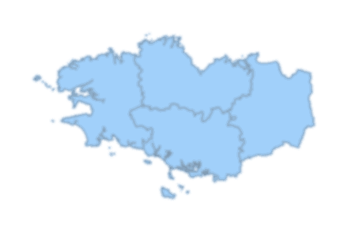

# Francle

**Un jeu de devinettes des régions françaises, inspiré de [Worldle](https://worldle.teuteuf.fr/).**

Une silhouette de région s'affiche : à toi de la reconnaître en 6 essais maximum.

**Version web, jouable en ligne : [deibine.github.io/francle-web](https://deibine.github.io/francle-web/)**
(dépôt [deIbine/francle-web](https://github.com/deIbine/francle-web)). Ce dépôt-ci est la version de bureau, en Java.

<p align="center">
  
  <br><em>Quelle est cette région ?</em>
</p>

## Règles

- Tu as **6 essais** pour trouver la région.
- Après chaque essai, le jeu t'indique :
  - la **distance** (en km ou en miles) entre la capitale de ta proposition et celle de la région à trouver ;
  - la **direction** à suivre (↑ nord, ↗ nord-est…) ;
  - un **pourcentage de proximité** (100 % = trouvé).
- Après chaque essai raté, un **indice** se dévoile : superficie, spécialité culinaire, personnalité,
  capitale régionale, puis monument ([liste des indices](docs/indices.md)).
- Proposer deux fois la même région ne coûte pas d'essai.
- À la fin, la **carte de France** colorie tes propositions, du jaune (loin) à l'orange (proche), et la réponse en
  vert si tu l'as trouvée (en bleu sinon) ; l'outre-mer est en encarts. Survoler une région donne son nom.
- La saisie est tolérante : majuscules, accents, espaces et tirets sont ignorés
  (`ile de france` = `Île-de-France`), et les noms anglais sont acceptés (`Brittany`).
  Des suggestions s'affichent pendant la frappe.

### Deux sortes de parties (menu *Jeu*)

- **Partie du jour** : la même région pour tout le monde, parmi les 18 régions actuelles, une seule partie par jour.
  Elle est retrouvée si l'on ferme le jeu, et alimente les **statistiques** (parties, victoires, séries).
- **Bonus des départements** : dès chaque victoire, on clique sur chacun des départements de la région, puis on
  écrit son nom ou son numéro (une réponse par département ; un zoom sur Paris pour l'Île-de-France ; au clavier,
  les flèches et Entrée). Pour une région d'un seul département (outre-mer), on donne son numéro. Le score moyen du
  bonus du jour s'ajoute aux statistiques. Pendant le bonus, la liste du menu *Jeu* (Ctrl+L) montre les
  départements de la région (les 101 dans la version difficile) : un clic sur un nom répond pour le département
  choisi.
- **Partager** (menu *Jeu* ou fenêtre des statistiques) : le résultat du jour en carrés 🟩🟨⬜, copié dans le
  presse-papiers, sans dévoiler la réponse.
- **Partie libre** : autant que tu veux, avec les régions actuelles ou les anciennes régions (avant 2016).

### Réglages (menu *Paramètres*, retenus d'un lancement à l'autre)

| Réglage | Choix |
|---|---|
| Régions de la partie libre | Nouvelles (depuis 2016) ou anciennes (avant 2016) |
| Silhouette de la région | Affichée ou cachée (plus difficile) |
| Silhouette tournée au hasard | Un angle au hasard, le même pour tous dans la partie du jour |
| Liste des régions (et des départements pendant le bonus), suggestions | Activées ou non |
| Bonus 🗺️ : départements, version difficile | La liste et les suggestions du bonus proposent les 101 départements, et non ceux de la région (💪 dans le partage) |
| Thème sombre | Clair ou sombre |
| Unités anglo-saxonnes | Kilomètres ou miles (miles par défaut en anglais) |
| Langue | Français ou anglais (par défaut, celle du système) |

## Lancer le jeu

**Prérequis :** un JDK (Java Development Kit) en version 21 ou plus. Vérifie avec `javac -version`.
Pas besoin d'installer Maven : le *Maven Wrapper* (`mvnw.cmd` sous Windows, `./mvnw` sous macOS et Linux)
télécharge la bonne version au premier lancement.

Depuis la racine du projet :

```bash
.\mvnw.cmd package
java -jar target/francle.jar
```

- `.\mvnw.cmd package` compile le code, lance les tests, puis assemble le jeu et ses images dans `target/francle.jar`.
- `java -jar` lance ce fichier, depuis n'importe quel dossier : les images sont lues à l'intérieur du `.jar`.
- `.\mvnw.cmd test` lance seulement les tests.

### Avec IntelliJ IDEA

*File > Open*, puis choisir le fichier `pom.xml` (*Open as Project*). IntelliJ lit le `pom.xml` et configure
seul le JDK, les dossiers de code, de ressources et de tests, et JUnit. Lancer ensuite la classe `Francle`
(`fr.francle.ui`), ou les tests par un clic droit sur `src/test/java` → *Run 'All Tests'*.

Projet déjà ouvert dans IntelliJ avant le passage à Maven ? Les anciens réglages manuels (racine marquée comme
dossier de code) restent et entrent en conflit avec Maven (erreur *Maven resources compiler: Failed to copy*).
Le plus simple : fermer IntelliJ, supprimer le dossier `.idea`, puis rouvrir le `pom.xml`.

## Structure du projet

```
francle/
├── pom.xml                    Description du projet pour Maven (Java 21, FlatLaf, Jackson, JUnit, .jar)
├── mvnw, mvnw.cmd, .mvn/      Maven Wrapper
├── src/
│   ├── main/java/fr/francle/  Code source du jeu, en quatre packages :
│   │   ├── donnees/           les régions et leurs informations, en deux langues (RegionFr, Departement…)
│   │   ├── jeu/               les règles, sans affichage (Partie, Bonus, Reponse, Indice, RegionDuJour…)
│   │   ├── stats/             l'historique des parties du jour et les statistiques, enregistrés en JSON
│   │   └── ui/                la fenêtre Swing (Francle, la classe à lancer)
│   ├── main/resources/        Silhouettes (regions/), textes en deux langues (textes/), départements de chaque
│   │                          région et leurs contours (departements/), contours de la France pour la carte de
│   │                          fin de partie (france.json)
│   └── test/java/fr/francle/  Tests JUnit, rangés dans les mêmes packages que les classes testées
├── outils/                    Le script Python qui produit les images et les contours des départements
├── .github/workflows/         Intégration continue : compilation et tests à chaque PR
├── docs/
│   ├── indices.md             Indices de chaque région
│   ├── feuille-de-route.md    Plan d'amélioration détaillé
│   └── lecons.md              Leçons de Java et de Git apprises à chaque phase
└── archive/
    └── projet-universitaire/  Version rendue en 2022 et sa documentation
```

## Feuille de route

Le détail de chaque phase est dans [docs/feuille-de-route.md](docs/feuille-de-route.md),
et ce qu'elle a permis d'apprendre dans [docs/lecons.md](docs/lecons.md).

- [x] **Phase 0.5** : dépôt Git propre (README, `.gitignore`, arborescence)
- [x] **Phase 0** : environnement de développement (JDK, IDE)
- [x] **Phase 1** : corriger les bugs (calcul de distance, réinitialisation des parties…)
- [x] **Phase 2** : centraliser les données des régions (`enum`, collections)
- [x] **Phase 3** : séparer la logique du jeu de l'affichage, Maven, tests JUnit, intégration continue, packages
- [x] **Phase 4** : interface Swing en une seule fenêtre, flèche de direction, autocomplétion
- [x] **Phase 5** : région du jour et statistiques
- [x] **Phase 6** : anciennes régions complètes, réglages enregistrés, thème sombre, miles, silhouette tournée
- [x] **Phase 7** : la version web, devenue un projet à part ([francle-web](https://github.com/deIbine/francle-web))
- [x] **Phase 8** : reprendre les nouveautés de la version web (6 essais, monument, doublons, anglais)
- [x] **Phase 9** : le bonus des départements (carte cliquable, zoom sur Paris, score moyen)
- [x] **Phase 10** : le bonus revu, repris du web (dès la victoire ; choisir un département, puis le nommer)
- [x] **Phase 11** : les corrections relevées en jouant (autre époque expliquée, indices montrés en fin de partie…)
- [x] **Phase 12** : la liste des départements pendant le bonus, reprise du web
- [x] **Phase 13** : le bonus simplifié (les départements de la région), et sa version difficile en option
- [x] **Phase 14** : la carte de fin en couleur (les propositions selon leur proximité, l'outre-mer en encarts)
- [x] **Phase 15** : les corrections de la revue (changement d'heure, minuit pendant le bonus, un seul jeu ouvert)
- [x] **Phase 16** : l'esthétique (silhouette nette, icône, proximité en couleur, thème sombre, indices, articles)
- [x] **Phase 17** : trois points d'interface (partie libre confirmée, suggestions sans doublons, liste grisée en outre-mer)

## Historique

Francle est né en 2022 comme projet universitaire, réalisé par
[deIbine](https://github.com/deIbine) et [Guitzoy](https://github.com/Guitzoy).
La version rendue est conservée dans [`archive/projet-universitaire`](archive/projet-universitaire).
Le projet est aujourd'hui repris pour être amélioré.

## Licence

Distribué sous licence MIT : voir [LICENSE](LICENSE).
