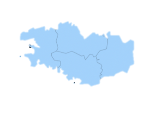

# Francle

**Un jeu de devinettes des régions françaises, inspiré de [Worldle](https://worldle.teuteuf.fr/).**

Une silhouette de région s'affiche : à toi de la reconnaître en 5 essais maximum.

<p align="center">
  
  <br><em>Quelle est cette région ?</em>
</p>

## Règles

- Tu as **5 essais** pour trouver la région.
- Après chaque essai raté, le jeu t'indique :
  - la **distance** (en km) entre ta proposition et la région à trouver ;
  - un **pourcentage de proximité** (100 % = trouvé) ;
  - un **indice** qui se dévoile au fil des essais : superficie, spécialité culinaire,
    personnalité, puis capitale régionale ([liste des indices](docs/indices.md)).
- La saisie est tolérante : majuscules, accents, espaces et tirets sont ignorés
  (`ile de france` = `Île-de-France`).

### Options (menu *Paramètres*)

| Option | Choix |
|---|---|
| Régions jouées | Nouvelles (depuis 2016), anciennes (avant 2016), ou toutes |
| Images | Avec ou sans silhouette (sans = plus difficile) |
| Liste des régions | Afficher ou non l'historique et la liste des régions possibles |

## Lancer le jeu

**Prérequis :** un JDK (Java Development Kit) en version 17 ou plus.
Vérifie avec `javac -version`.

Depuis la racine du projet (les images sont chargées avec un chemin relatif) :

```bash
javac -encoding UTF-8 -d out main.java
java -cp out main
```

- `javac` compile le code source en *bytecode* (`.class`) dans le dossier `out/`.
- `java` lance la classe `main` en cherchant les `.class` dans `out/` (`-cp` = *classpath*).

## Structure du projet

```
francle/
├── main.java                  Code source du jeu
├── regions/                   Silhouettes des régions affichées en jeu
├── indices/                   Cartes de localisation des régions (pas encore utilisées)
├── docs/
│   ├── indices.md             Indices de chaque région
│   └── feuille-de-route.md    Plan d'amélioration détaillé
└── archive/
    └── projet-universitaire/  Version rendue en 2022 et sa documentation
```

## Feuille de route

Le détail de chaque phase est dans [docs/feuille-de-route.md](docs/feuille-de-route.md).

- [x] **Phase 0.5** : dépôt Git propre (README, `.gitignore`, arborescence)
- [ ] **Phase 0** (en cours) : environnement de développement (JDK, IDE)
- [ ] **Phase 1** : corriger les bugs (calcul de distance, réinitialisation des parties…)
- [ ] **Phase 2** : centraliser les données des régions (`enum`, collections)
- [ ] **Phase 3** : séparer la logique du jeu de l'affichage, tests JUnit, Maven/Gradle
- [ ] **Phase 4** : interface Swing en une seule fenêtre, flèche de direction
- [ ] **Phase 5** : statistiques, région du jour, indices des anciennes régions

## Historique

Francle est né en 2022 comme projet universitaire, réalisé par
[deIbine](https://github.com/deIbine) et [Guitzoy](https://github.com/Guitzoy).
La version rendue est conservée dans [`archive/projet-universitaire`](archive/projet-universitaire).
Le projet est aujourd'hui repris pour être amélioré.

## Licence

Distribué sous licence MIT : voir [LICENSE](LICENSE).
